<h1 align="center">
  <picture>
    <source media="(prefers-color-scheme: dark)" srcset=".github/assets/dark.svg">
    <source media="(prefers-color-scheme: light)" srcset=".github/assets/light.svg">
    
  </picture>
</h1>

<p align="center">
  <a href="https://certificate.hack2skill.com/verify/2026H2S07SCBWAI-TH00277">
    
  </a>
  <a href="https://certopus.com/c/b3ad40bfbc0e487fa38d85e63f1a6a1d">
    
  </a>
  <a href="https://www.instagram.com/stories/highlights/17960975343009953/">
    
  </a>
  <a href="https://leetcode.com/u/Vortex-16/">
    
  </a>
  <a href="https://takeuforward.org/profile/vortex16">
    
  </a>
  
</p>

---

```bash
      /\            vikash@archcraft
     /  \          --------------------
    /\   \         OS       :: Arch Linux x86_64
   /      \        Kernel   :: Linux 6.x (zen)
  /   ,,   \       WM       :: bspwm + picom + polybar
 /   |  |  -\      Terminal :: kitty (zsh + starship)
/_-''    ''-_\     Editor   :: Neovim + VS Code
                   Academic :: B.Tech in CSE
                   Core     :: Systems Architecture, OS Dev, Compilers
                   Building :: Custom x86_64 OS, DevTrack, VAni
```

---

### Stack & Tooling

```bash
[systems & low-level]   C  •  C++  •  x86_64 Assembly  •  Linux Kernel  •  Bash
[full-stack]            TypeScript  •  React  •  Next.js  •  Node.js  •  Express  •  PostgreSQL
[infrastructure]        Docker  •  Git  •  Firebase  •  Linux SysAdmin
[environment]           ArchCraft  •  bspwm  •  Neovim  •  Kitty  •  Polybar
```

---

### Current Focus

- Developing a bare-metal custom Operating System from scratch (`x86_64`, bootloader, memory paging)
- Low-level kernel internals, process scheduling, and concurrency mechanics
- Building high-performance developer analytics & voice-first AI companions
- Exploring modern memory safety patterns and systems programming

---

### Selected Engineering Projects

<div align="center">

| Project | Description | Stack |
| :--- | :--- | :--- |
| [**DevTrack**](https://devtrack-pwkj.onrender.com/) | Developer analytics engine tracking repository velocity, stale branches, and engineering habits. | `React` `Node.js` `Firebase` `GitHub API` |
| [**VAni**](https://github.com/Vortex-16/VAni/releases/download/v1.0.0/VAni.apk) | Voice-first healthcare companion with prescription OCR, automated reminders, and multilingual triage. | `React Native` `Expo` `Node.js` `PostgreSQL` `Gemini` |
| [**Arynox LLM**](https://Arynox-llm.onrender.com) | Contextual Socratic RAG tutor for computer science students with document chunking & vector retrieval. | `React` `Groq` `ChromaDB` `LangChain` |
| [**NewsAI**](https://your-newsai-link.com) | Real-time news pipeline delivering instant, structured summaries using automated LLM ingestion. | `React` `Node.js` `MongoDB` `JWT` `Gemini` |
| [**Punarchakra**](https://punarchakra.vercel.app) | Circular economy e-waste logistics platform incentivizing sustainable electronics recycling. | `Next.js` `TypeScript` `Leaflet` |

</div>

---

<details>
<summary><b>Web Interfaces & Community Platforms (Click to expand)</b></summary>

<br>

<div align="center">

| Platform | Domain / Scope | Tech |
| :--- | :--- | :--- |
| [**VikashOS**](https://vikashos.netlify.app/) | Arch Linux-inspired web desktop recreating window management and shell semantics. | `Desktop Web UI` `Terminal UX` |
| [**STCET Coding Cell**](https://stcet-coding-cell.onrender.com/) | Official community platform for competitive programmers and tech symposiums. | `Community Platform` `Responsive Web` |
| [**SREY 2K26**](https://srey2k26.vercel.app/) | High-concurrency college tech-fest portal for registrations and scheduling. | `Event Infrastructure` `Next.js` |
| [**CodeFlow**](https://codeflow-srey.stcet.ac.in/) | Official hackathon portal handling team submissions, rules, and live tracking. | `Event Portal` `Web UI` |
| [**PragatiPath**](https://pragatipath.onrender.com/) | Lightweight e-learning platform optimized for accessibility and low-bandwidth connections. | `Accessible UI` `EdTech` |
| [**TechBaithak**](https://stcet-coding-cell-techbaithak.netlify.app/) | Interactive community space with gamified challenges and activity leaderboards. | `Gamified UX` `Frontend` |
| [**Developer Portfolio**](https://vikash.is-a.dev/) | Personal space documenting engineering logs, hardware setups, and builds. | `Personal Site` `Modern UI` |
| [**Fairy Portfolio**](https://vikash-fairy.netlify.app/) | Experimental motion-design web space powered by high-framerate GSAP transitions. | `GSAP` `Creative Frontend` |

</div>

</details>

<details>
<summary><b>Production & Client Systems (Click to expand)</b></summary>

<br>

<div align="center">

| Client / Product | Focus | Solution |
| :--- | :--- | :--- |
| [**Maa Janki Hospital**](https://maa-janki-hospital-dr-amrit.vercel.app/) | Healthcare Operations | Patient digital portal, directory services, and appointment workflows. |
| [**Shreya Saree**](https://shreya-saree.netlify.app/) | Retail Catalog | Fast, mobile-first inventory showcase and inquiry channel for retail clients. |

</div>

</details>

---

### Workstation & Environment

<p align="center">
  
</p>

```
OS: ArchCraft (Linux 6.x) | WM: bspwm + picom + polybar | Terminal: kitty + zsh | Editor: Neovim
```

---

### 🧠 Engineering Stats

<br/>


---

### 🤝 Let's Connect

<p align="center">
  <a href="https://in.linkedin.com/in/vikash-gupta-16devlop/"></a>
  <a href="https://x.com/GUPTA16VIKASH"></a>
  <a href="mailto:vikash9c35@gmail.com"></a>
</p>

<p align="center">
  <a href="https://www.buymeacoffee.com/VikashG">
    
  </a>
</p>

<div align="center">
  
</div>
